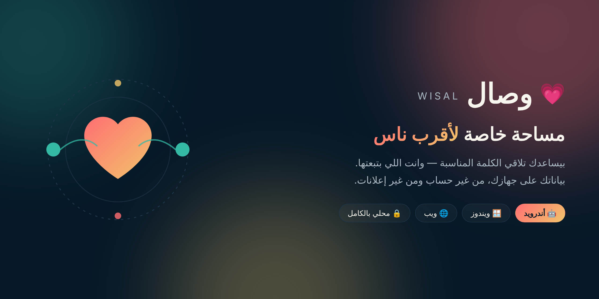
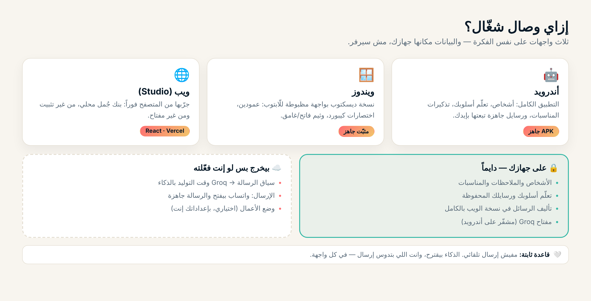

<div align="center">



<h1>وصال · Wisal</h1>

**مساحة خاصة لأقرب ناس.** بيساعدك تلاقي الكلمة المناسبة — وانت اللي بتبعتها.

[](https://github.com/ahmadzayan-hub/Maktab-/releases/download/android-latest/wisal.apk)
[](https://github.com/ahmadzayan-hub/Maktab-/releases/download/windows-latest/Wisal-Setup.exe)
[](wisal-studio/)
[](https://github.com/ahmadzayan-hub/Maktab-/actions/workflows/android.yml)
[](https://github.com/ahmadzayan-hub/Maktab-/actions/workflows/desktop.yml)

[التحميل](#-التحميل) · [جرّبها في المتصفح](#-جرّبها-في-المتصفح) · [إزاي بتشتغل](#️-إزاي-بتشتغل) · [الخصوصية](#-الخصوصية-بالظبط) · [للمطوّرين](#-للمطوّرين)

</div>

---

## إيه ده؟

تطبيق بيساعدك تفضل قريّب من أهلك وأصحابك. مش شبكة اجتماعية ولا مساعد بيتكلم بالنيابة عنك —
فكرته بسيطة: ساعات بتكون عايز تبعت كلمة حلوة لحد بتحبه ومش لاقي الصياغة، فـ**وصال بيقترح، وانت
بتعدّل وتبعت بإيدك**.

> [!IMPORTANT]
> **مفيش إرسال تلقائي. خالص.** الذكاء الاصطناعي بيقترح الصياغة بس — الضغطة الأخيرة على "إرسال"
> بإيدك إنت، في كل واجهة. دي قاعدة مفروضة في الكود نفسه، مش وعد في README.

---

## 📥 التحميل

| المنصّة | الملف | الحجم | ملاحظات |
| --- | --- | --- | --- |
| 🤖 **أندرويد 8+** | [`wisal.apk`](https://github.com/ahmadzayan-hub/Maktab-/releases/download/android-latest/wisal.apk) | ~118 MB | أجهزة ARM64. أول تثبيت محتاج تسمح بـ"مصادر غير معروفة". |
| 🪟 **ويندوز 10+** | [`Wisal-Setup.exe`](https://github.com/ahmadzayan-hub/Maktab-/releases/download/windows-latest/Wisal-Setup.exe) | ~112 MB | تثبيت بدون صلاحيات أدمن. فيه كمان [نسخة محمولة](https://github.com/ahmadzayan-hub/Maktab-/releases/download/windows-latest/Wisal-Portable.exe). |
| 🌐 **ويب** | [`wisal-studio/`](wisal-studio/) | — | بيشتغل في المتصفح فوراً، من غير تثبيت. |

> النسخ دي **مش موقّعة تجارياً** لسه. ويندوز هيطلّع تحذير SmartScreen أول مرة
> (More info → Run anyway)، وده متوقّع. التفاصيل في [حالة المشروع](#-حالة-المشروع-بصراحة).

---

## 🌐 جرّبها في المتصفح

`wisal-studio/` نسخة ويب تفاعلية (React + Vite) بتشتغل **محلياً بالكامل**: اختار الشخص والنيّة
واللهجة، وخد رسالة جاهزة تنسخها أو تفتحها في واتساب.

```bash
cd wisal-studio
npm install
npm run dev          # http://localhost:5173
```

**ليه دي مهمة؟** مفيش مفتاح، مفيش حساب، ومفيش أي طلب شبكة — الصياغة بتتولّد من بنك جُمل محلي
مكتوب بأربع لهجات (مصري · خليجي · شامي · فصحى) مع مطابقة صحيحة للمذكّر والمؤنث. يعني تقدر
تجرّب المنتج فعلياً من غير ما تثبّت حاجة أو تسلّم بياناتك لأي حد.

النشر على Vercel: Root Directory = `wisal-studio`، والباقي افتراضي (Vite preset).

---

## 🏗️ إزاي بتشتغل

<div align="center">
  
</div>

---

## 🔒 الخصوصية بالظبط

بدل كلام عام، ده اللي بيحصل فعلاً:

| البيانات | فين بتتخزّن؟ | بتخرج من الجهاز؟ |
| --- | --- | --- |
| أشخاصك، ملاحظاتك، مناسباتك | جهازك | ❌ |
| تعلّم أسلوبك ورسايلك المحفوظة | جهازك | ❌ |
| تأليف الرسائل في نسخة الويب | متصفحك | ❌ — صفر طلبات شبكة |
| مفتاح Groq | مشفّر عبر Android Keystore (أندرويد) | يتبعت لـGroq كترويسة مصادقة |
| سياق الرسالة وقت التوليد بالذكاء | — | ✅ يتبعت لـ**Groq** عشان يكتب الاقتراح |
| رقم واتساب والرسالة | — | بيتفتحوا في واتساب، وانت بتدوس Send |

**مفيش سيرفر لوصال بيجمع بياناتك.** الباك-إندات الموجودة في الريبو (`wisal-cloud-api`,
`wisal-direct-relay`) **اختيارية وبتنشرها إنت بنفسك** لو عايز وضع الأعمال — مش خدمة بنشغّلها
إحنا.

سياسة الخصوصية الكاملة: [`wisal-web/privacy.html`](wisal-web/privacy.html).

---

## 📦 محتويات الريبو

ده **monorepo** فيه أكتر من منتج. كل مجلد مستقل وله بناء ونشر خاص بيه:

### وصال (Wisal)
| المجلد | إيه ده | التقنية |
| --- | --- | --- |
| [`android-wife-assistant/`](android-wife-assistant/) | تطبيق أندرويد (المنتج الأساسي) | Kotlin · Jetpack Compose |
| [`wisal-desktop/`](wisal-desktop/) | تطبيق ويندوز | Electron |
| [`wisal-studio/`](wisal-studio/) | نسخة الويب التفاعلية | React · Vite |
| [`wisal-web/`](wisal-web/) | صفحة الهبوط وسياسة الخصوصية | HTML/CSS ثابت |
| [`telegram-wife-assistant/`](telegram-wife-assistant/) | بوت تيليجرام (مساعد شخصي للمالك بس) | Node.js |
| [`wisal-cloud-api/`](wisal-cloud-api/) | باك-إند اختياري لواتساب Business | Node · Vercel Functions |
| [`wisal-direct-relay/`](wisal-direct-relay/) | ترحيل مغلّفات مشفّرة (طور التطوير) | Node · Vercel Functions |

### مشاريع تانية في نفس الريبو
| المجلد | إيه ده |
| --- | --- |
| [`src/`](src/) (الجذر) | **Lahza** — تطبيق ويب لهدايا القهوة (Vite · React · TS) |
| [`landing/`](landing/) | **Beyond Style UAE** — صفحة هبوط لعلامة مجوهرات |
| [`agent-os/`](agent-os/) · [`agentic-os/`](agentic-os/) | طبقات تنظيمية/حوكمة للعمل على الريبو |

تفاصيل أوسع: [`PROJECTS.md`](PROJECTS.md).

---

## 🧪 للمطوّرين

```bash
# نسخة الويب
cd wisal-studio && npm install && npm run dev && npm test

# تطبيق ويندوز
cd wisal-desktop && npm install && npm start && npm test

# تطبيق أندرويد
cd android-wife-assistant && ./gradlew testDebugUnitTest

# البوت والباك-إندات
cd telegram-wife-assistant && npm install && npm test
cd wisal-cloud-api && npm run check && npm test
cd wisal-direct-relay && npm run check && npm test
```

كل مشروع ليه workflow في [`.github/workflows/`](.github/workflows/) بيشتغل على تعديلات مجلده بس.

---

## 📋 حالة المشروع (بصراحة)

شفافية أهم من تسويق. ده الوضع الحقيقي قبل أي نشر عام:

| البند | الحالة |
| --- | --- |
| تطبيق أندرويد وويندوز | ✅ شغّالين، ببناء آلي على كل تعديل |
| نسخة الويب | ✅ شغّالة محلياً بالكامل، 15 اختبار للمحرّك |
| تشفير E2EE | ⚠️ **مش مُعلَن ومش مكتمل.** libsignal متكامل في الكود لكنه مش موصول بأي مسار رسائل، و`mayClaimE2ee = false`. مفيش أي ادعاء تشفير في الواجهة. |
| توقيع التطبيقات | ⚠️ النسخ الحالية موقّعة بمفتاح تطوير — **لازم مفتاح رفع حقيقي قبل Google Play** |
| الترخيص | ⚠️ **مفيش ملف ترخيص لسه.** `libsignal-android` مرخّص AGPL-3.0، وده بيفرض التزامات على التوزيع — قرار الترخيص لسه مفتوح |
| `wisal-direct-relay` | ⚠️ تخزين في الذاكرة — **مش جاهز للإنتاج**، ومفيش ميزة شغّالة بتعتمد عليه |

---

## 🤝 المساهمة والأمان

- إزاي تساهم: [`CONTRIBUTING.md`](CONTRIBUTING.md)
- تبليغ ثغرة أمنية: [`SECURITY.md`](SECURITY.md) — **من فضلك متفتحش Issue عام بثغرة**

---

<div align="center">
  <sub>اتعمل بـ💗 لأقرب ناس · <a href="wisal-web/privacy.html">الخصوصية</a> · <a href="PROJECTS.md">كل المشاريع</a></sub>
</div>
