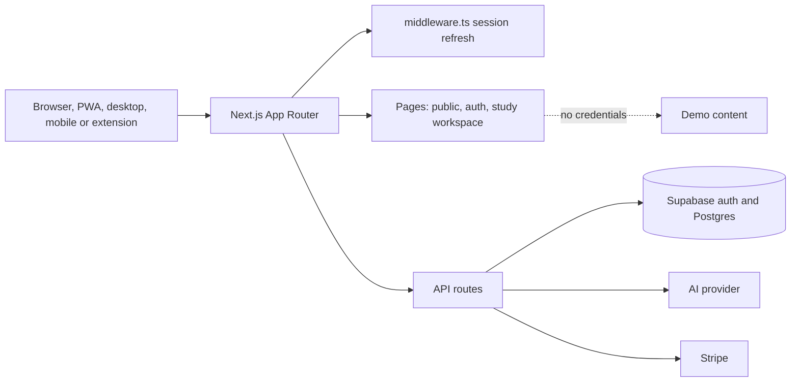

<p align="center">
  
</p>

<p align="center"><br><sub><em>Concept image (AI-generated). Not a product screenshot.</em></sub></p>

> [!IMPORTANT]
> **This repository is NOT canonical for Maktab. `ahmadzayan-hub/maktab` is.**
>
> Decided by the owner on 2026-08-24. Do not open pull requests against the
> application code here. `maktab` is ahead (the Next 15 async-cookies
> migration across 38 call sites, plus `StudyCommandCenter` and
> `readiness.ts`, which this copy does not have).
>
> **This repo is still deployed on purpose, and must stay that way for now.**
> `desktop-tutorial-kappa-five.vercel.app` is the URL that ZAIan Studio's
> shipped desktop, mobile and browser-extension clients open by default.
> See `promptops/desktop/main.js`, `mobile/capacitor.config.ts`,
> `extension/content.js` and `extension/options.js`. Those clients currently
> show Maktab, which is a live bug. Taking this deployment down would turn a
> wrong app into a dead one. It can be retired once those shells point
> somewhere correct. Tracked in `docs/portfolio-audit/DUPLICATE_ANALYSIS.md`.
>
> What is unique here: `docs/portfolio-audit/`, the portfolio audit, and the
> `desktop/`, `extension/` and `mobile/` shells.

<p align="center"><strong>Your MBA, on one desk. A bilingual English and Arabic study workspace for MBA students, managers and entrepreneurs.</strong></p>

<p align="center">
  
  
  
  
  
  
  
  
</p>

## Overview

Maktab brings an MBA student's courses, lectures, tasks, grades, study packs, group projects, flashcards, quizzes, weekly briefs and an AI study tutor into one calm, mobile-first workspace. It is bilingual (English and Arabic) with a real RTL layout.

Maktab boots with **no backend credentials**. In that mode `/`, `/login` and `/signup` redirect to `/dashboard`, and every page renders sample content. Add Supabase keys to enable real auth and persistence.

## Key features

- **Ask MBA**: an AI tutor grounded in business-school topics.
- **Weekly Brief**: a summary of what is due, what to study and what to prepare.
- **Study Packs**: bundle lecture notes, flashcards and quizzes for a topic or an exam.
- **Group Project**: coordinate roles, deliverables and deadlines with a team.
- **Grades and Timeline**: see where you stand and what comes next.
- **Files, Messages, Announcements**: one inbox for programme updates.
- **Bilingual EN / AR** with RTL layout and native fonts (Space Grotesk, Fraunces, Tajawal, IBM Plex Sans Arabic, JetBrains Mono), plus light and dark themes.
- **Installable PWA** with a service worker (`public/sw.js`) and web manifest.
- **Client shells**: Electron (`desktop/`), Capacitor (`mobile/`) and a Manifest V3 browser extension (`extension/`).

## Screenshots

Screenshots are from a local production build with no credentials, so they show **demo content** (sample student and courses).

| Desktop (1440 x 900) | Mobile (390 x 844) |
|---|---|
|  |  |
|  |  |

## Quick start

Requirements: Node.js 20 or later.

```bash
npm ci
cp .env.example .env.local   # optional: Supabase, AI provider, Stripe
npm run dev                  # http://localhost:3000
```

Add `NEXT_PUBLIC_SUPABASE_URL` and the Supabase key to enable real auth and persistence. The code reads both `NEXT_PUBLIC_SUPABASE_ANON_KEY` and `NEXT_PUBLIC_SUPABASE_PUBLISHABLE_KEY`, so set both to the same value. Add `OPENAI_API_KEY` (server only) for higher-quality Ask MBA responses, and the `STRIPE_*` variables for the subscription page.

## Scripts

| Command | Purpose |
|---|---|
| `npm run dev` | Start the development server |
| `npm run build` | Production build |
| `npm start` | Serve the production build |
| `npm run lint` | ESLint (`next lint`) |
| `npm run typecheck` | TypeScript check (`tsc --noEmit`) |
| `npm test` | Vitest unit tests (37 tests) |
| `npm run test:e2e` | Playwright public-surface E2E (boots the dev server) |

## Project structure

```
.
├── src/
│   ├── app/
│   │   ├── (app)/         Study workspace (23 pages)
│   │   ├── (auth)/        Login, signup, reset-password
│   │   ├── (public)/      Landing, pricing, features, FAQ, terms, privacy
│   │   ├── api/           API route handlers (ask-mba, tutor, tasks, files and more)
│   │   ├── admin/         Feedback console
│   │   ├── layout.tsx     Root layout, fonts, PWA registration
│   │   └── sitemap.ts     SEO sitemap
│   ├── lib/               engine, safe-fetch, supabase, i18n, services
│   ├── components/        UI kit (glass cards, motion, icons, forms)
│   └── middleware.ts      Supabase session refresh
├── public/                icon, manifest.webmanifest, sw.js, offline assets
├── supabase/              migrations, seed
├── e2e/                   Playwright tests
├── extension/             Browser extension (MV3)
├── mobile/                Capacitor scaffold
├── desktop/               Electron wrapper
├── docs/                  Audit, API, architecture, mobile, desktop notes, portfolio audit
├── vercel.json            Deploy config
└── tailwind.config.ts     Design tokens (brand, navy, teal, gold)
```

Sibling products that used to live in this repository now have their own repositories: [wisal](https://github.com/ahmadzayan-hub/wisal), [lahza](https://github.com/ahmadzayan-hub/lahza), [masaar](https://github.com/ahmadzayan-hub/masaar), [vertex](https://github.com/ahmadzayan-hub/vertex), [mutabasir](https://github.com/ahmadzayan-hub/mutabasir), [annual-operation-plan-2026](https://github.com/ahmadzayan-hub/annual-operation-plan-2026).

## Architecture



See [`docs/ARCHITECTURE.md`](docs/ARCHITECTURE.md) and [`docs/API.md`](docs/API.md) for detail.

## Deploy on Vercel

`vercel.json` is already in the repository.

| Setting | Value |
|---|---|
| Framework preset | Next.js |
| Root directory | `.` (repository root) |
| Install command | `npm install` (set in `vercel.json`) |
| Build command | `npm run build` |
| Output directory | `.next` |
| Region | `iad1` (set in `vercel.json`) |

`vercel.json` sets `NEXT_PUBLIC_DEMO_MODE=true`. The build needs no secrets. For live auth, AI and billing, add these from [`.env.example`](.env.example):

| Variable | Purpose |
|---|---|
| `NEXT_PUBLIC_SUPABASE_URL` | Supabase project URL |
| `NEXT_PUBLIC_SUPABASE_ANON_KEY`, `NEXT_PUBLIC_SUPABASE_PUBLISHABLE_KEY` | Supabase public key (set both to the same value) |
| `SUPABASE_SERVICE_ROLE_KEY` | Server-side privileged access |
| `AI_PROVIDER`, `ANTHROPIC_API_KEY`, `OPENAI_API_KEY` | AI tutor provider and keys |
| `STRIPE_SECRET_KEY`, `STRIPE_WEBHOOK_SECRET`, `NEXT_PUBLIC_STRIPE_PUBLISHABLE_KEY`, `STRIPE_*_PRICE_ID` | Subscription billing |
| `NEXT_PUBLIC_APP_URL` | Public app URL |
| `EMAIL_FROM`, `RESEND_API_KEY` | Optional digest emails |

## Quality gates

```bash
npm run typecheck    # tsc --noEmit
npm run lint         # next lint
npm test             # vitest run
npm run test:e2e     # playwright
npm run build        # next build
```

CI (`.github/workflows/ci.yml`) runs typecheck, lint, tests, build, an `npm audit` critical check and the Playwright public-surface suite.

## Design

To regenerate a screen with an AI design tool, start from [docs/DESIGN_GENERATION_PROMPT.md](docs/DESIGN_GENERATION_PROMPT.md). It is grounded in the exact tokens, fonts, palette and route paths, with per-tool tuning notes at the bottom.

A CI check (`.github/workflows/design-prompt-drift.yml`) fails any PR that changes `src/app/globals.css`, `tailwind.config.ts`, or a route inside `src/app/(app|public|auth)/` without also updating the prompt. Add `[skip-design-drift]` to a PR title or commit message to acknowledge intentional drift.

## Status and known limitations

- **Not canonical.** Product development happens in `ahmadzayan-hub/maktab`. This copy is kept deployed only for the reason in the notice above.
- Without credentials, all workspace pages show demo content. Some demo numbers do not agree with each other (for example, the dashboard greeting mentions 5 active courses while the stat card shows 0).
- `docs/DEPLOY.md` still describes an Ollama and extension setup from an earlier product and does not match the current `.env.example`. Use the Vercel section above.
- `npm run lint` reports one warning (`@next/next/no-page-custom-font` in `src/app/layout.tsx`).

## Docs

- `docs/PROJECT_AUDIT_BASELINE.md`: current-state audit and findings
- `docs/API.md`: API reference
- `docs/ARCHITECTURE.md`: architecture notes
- `docs/MOBILE.md`: installable PWA and Capacitor wrapper
- `docs/DESKTOP.md`: Electron wrapper
- `docs/portfolio-audit/`: portfolio audit (unique to this repository)

## الملخص العربي

<div dir="rtl" lang="ar">

**مكتب** منصة دراسية ثنائية اللغة (العربية والإنجليزية) لطلاب ماجستير إدارة الأعمال والمديرين ورواد الأعمال. تجمع المقررات والمحاضرات والمهام والدرجات وحزم المذاكرة والمشاريع الجماعية والبطاقات التعليمية والاختبارات والملخص الأسبوعي ومساعداً دراسياً بالذكاء الاصطناعي في مساحة عمل واحدة تدعم الهاتف المحمول والاتجاه من اليمين إلى اليسار.

**تنبيه مهم:** هذا المستودع ليس المرجع المعتمد لمنصة مكتب؛ المستودع المعتمد هو `ahmadzayan-hub/maktab`. يبقى هذا المستودع منشوراً عمداً لأن تطبيقات سطح المكتب والهاتف وإضافة المتصفح تفتح رابطه افتراضياً، ولا يُقبل فيه تطوير على شيفرة التطبيق.

يعمل التطبيق دون أي بيانات اعتماد بمحتوى تجريبي، ويمكن نشره على Vercel دون متغيرات بيئة إلزامية.

</div>

## License and ownership

Owned by Ahmed Zaian. No license file is included, so no open-source license is granted. All rights reserved.
